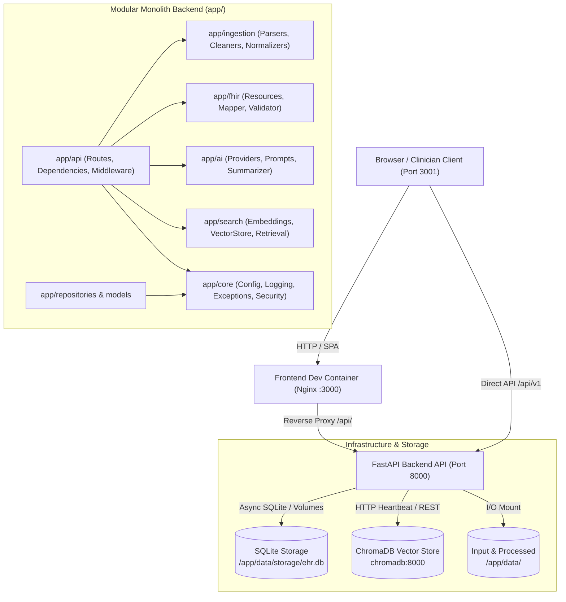

# EHR Intelligence Platform - System Architecture & Engineering Blueprint

## 1. Architectural Strategy: Modular Monolith

The **EHR Intelligence Platform** is architected as a **Modular Monolith**. 

### Rationale
- **Clinical Interoperability & Transactional Integrity:** Healthcare records require strict transactional guarantees, atomic writes across relational tables, and low-latency access during ingestion. A distributed microservice topology at this stage would introduce distributed transactions (2PC/Saga complexity), network serialization overhead, and deployment friction without any scalability gains.
- **Strict Boundary Separation:** Code is organized by clinical domain capabilities (`ingestion`, `fhir`, `ai`, `search`, `models`, `repositories`, `services`). Domains communicate via well-defined internal interfaces rather than inter-service HTTP/gRPC overhead, while maintaining the flexibility to be extracted into independent services if scaling demands require it.
- **Unified Operational Surface:** A single backend API runtime simplifies compliance auditing, configuration management, logging, monitoring, and local containerized development.

---

## 2. System Overview & Component Diagram

---

## 3. Service Responsibilities & Communication Boundaries

| Module / Service | Path | Core Responsibility | Communication Boundaries |
| :--- | :--- | :--- | :--- |
| **Core** | `app/core/` | Centralized settings (Pydantic v2), structured logging, global exception handling, security context. | Cross-cutting dependency used across all layers. |
| **API** | `app/api/` | FastAPI routes, parameter validation, request/response models, dependency injection. | Entry point for HTTP clients. Calls domain services. |
| **Ingestion** | `app/ingestion/` | Extraction, cleaning, and normalization of medical notes, HL7, CDA, and clinical feeds. | Hands parsed data to `fhir` or `search`. |
| **FHIR** | `app/fhir/` | Conversion to FHIR R4 standard models, schema validation, and clinical terminology mapping. | Used by `ingestion` and API endpoints. |
| **AI** | `app/ai/` | LLM client orchestration (OpenAI, Anthropic), clinical prompting, and longitudinal encounter summarization. | Consumes retrieved records; produces summaries. |
| **Search** | `app/search/` | Dense clinical vector embeddings (`sentence-transformers`), ChromaDB integration, and hybrid retrieval. | Communicates over HTTP with `chromadb:8000`. |
| **Repositories** | `app/repositories/` | Data access objects and query encapsulation for SQLite. | Direct SQLite file I/O via SQLAlchemy/aiosqlite. |
| **Frontend** | `frontend/` | Nginx development container serving modern UI and reverse-proxying API calls. | Communicates with backend over Docker bridge network. |

---

## 4. Docker & Container Infrastructure

### Services in `docker-compose.yml`

1. **`backend` (FastAPI / Uvicorn)**
   - Base Image: `python:3.11-slim`
   - Internal Port: `8000` | Host Port: `8000` (configurable via `BACKEND_PORT`)
   - Non-root user: `appuser` (UID 1000)
   - Dev Mount: `.:/app` for live code reload without rebuilding.
   - Anonymous pycache volume to prevent host/container bytecode collision.
   - Healthcheck: polls `http://localhost:8000/health` every 10s.

2. **`chromadb` (ChromaDB Vector Database)**
   - Image: `chromadb/chroma:0.5.23`
   - Internal Port: `8000` | Host Port: `8001` (configurable via `CHROMA_HOST_PORT`)
   - Internal Docker service name: `chromadb`
   - Persistence directory: `/chroma/data` mounted to named volume `chroma_data`.
   - Healthcheck: polls `http://localhost:8000/api/v1/heartbeat` every 10s.

3. **`frontend` (Nginx Development Server)**
   - Base Image: `nginx:1.25-alpine`
   - Internal Port: `3000` | Host Port: `3001` (configurable via `FRONTEND_PORT`)
   - Dev Mount: `./frontend:/usr/share/nginx/html:ro` for immediate UI preview.
   - Built-in reverse proxy routing `/api/` to `http://backend:8000`.
   - Healthcheck: polls `http://localhost:3000/health` every 10s.

### Networking
- **Network Name:** `ehr-network`
- **Driver:** `bridge`
- **Resolution:** Internal DNS allows `backend` to address `chromadb` by name (`http://chromadb:8000`).

### Persistent Storage
- **`sqlite_data`:** Named volume mapped to `/app/data/storage`. Guarantees structured SQLite databases survive container recreation and stops.
- **`chroma_data`:** Named volume mapped to `/chroma/data`. Retains vector embeddings and similarity indices.
- **`app_data_input`:** Named volume mapped to `/app/data/input`. Retains uploaded raw medical notes/documents.
- **`app_data_processed`:** Named volume mapped to `/app/data/processed`. Stores normalized intermediate artifacts.

---

## 5. Security & Isolation Controls

- **Non-Root Execution:** Backend executes under a dedicated unprivileged user (`appuser`).
- **Secret Segregation:** No credentials, API tokens, or keys are baked into images. Environment variables are loaded via `.env` and injected by Docker Compose.
- **Scoped Port Bindings:** ChromaDB internal port `8000` is remapped to `8001` on host to prevent conflicts with the backend API.
- **CORS Allow-listing:** Only explicitly configured frontend origins (`http://localhost:3000`, `http://localhost:3001`) are granted cross-origin access.
