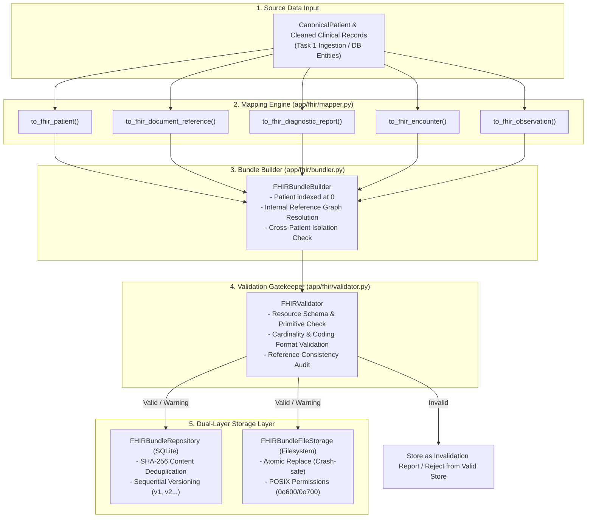

# HL7 FHIR R4 Normalization Pipeline

## 1. Architectural Strategy & Overview

The **FHIR R4 Normalization Pipeline** transforms cleaned, validated EHR intermediate representations (`CanonicalPatient`, `CanonicalClinicalRecord`, and their underlying persistence models) into standardized, interconnected **HL7 FHIR R4** resources wrapped into deterministic patient bundles.

### Core Objectives
1. **Clinical Fidelity & Non-Fabrication**: Map actual clinical entities into standard FHIR R4 representations without hallucinating or inventing missing clinical values (such as fake encounters, diagnoses, or observations).
2. **Deterministic Bundle Composition**: Package resources into per-patient `collection` or `transaction` bundles with stable, UUIDv5/UUIDv4 identifiers and verified reference graphs.
3. **Deep Conformance & Integrity Validation**: Employ `fhir.resources.R4B` schema validation coupled with structural reference verification, primitive checks, and cross-patient isolation audits.
4. **Gatekeeper Persistence**: Ensure invalid bundles are flagged and prevented from entering the validated output store.
5. **Dual-Layer Persistence**: Provide an ACID relational store (SQLite `fhir_bundles` with SHA-256 deduplication and sequential versioning) alongside atomic filesystem persistence with strict POSIX permissions (`0o600` for files, `0o700` for directories).

---

## 2. Pipeline Workflow & Component Topology

---

## 3. FHIR R4 Resource Mapping Decisions

### 3.1 Patient (`app/fhir/mapper.py::to_fhir_patient`)
- **Identifiers**:
  - Primary MRN mapped with system `urn:oid:1.3.6.1.4.1.21367.13.20.1000` (or configured healthcare authority system) and `type.coding: [{"code": "MR", "system": "http://terminology.hl7.org/CodeSystem/v2-0203"}]`.
  - Secondary identifiers (SSN, national IDs) preserved when present.
- **Demographics**:
  - `name`: Built with `use="official"`, `family`, and `given` array.
  - `gender`: Mapped to standard FHIR administrative gender codes (`male`, `female`, `other`, `unknown`).
  - `birthDate`: Strict ISO-8601 `YYYY-MM-DD` formatting.
  - `telecom` & `address`: Mapped when contact information is present.
  - `active`: Defaults to `True`.

### 3.2 DocumentReference (`app/fhir/mapper.py::to_fhir_document_reference`)
- **Clinical Meaning**: Represents unstructured and semi-structured notes (progress notes, discharge summaries, consult notes, nursing notes).
- **Status**: Mapped from clinical record status (`current`, `superseded`, `entered-in-error`), defaulting to `current`.
- **Type & Category**:
  - LOINC coding applied (e.g., `11488-4` for Consultation note, `34117-2` for History and Physical note).
  - Category tagged with `clinical-note`.
- **Subject Reference**: Strictly formatted as `Patient/{patient_id}`.
- **Encounter Reference**: Linked as `Encounter/{encounter_id}` if and only if valid encounter context is available. No synthetic encounter is generated if missing.
- **Content & Attachments**:
  - Body text encoded as Base64 payload in `attachment.data` with `contentType="text/plain; charset=utf-8"`.
  - `attachment.title` and `attachment.creation` timestamp populated.

### 3.3 DiagnosticReport (`app/fhir/mapper.py::to_fhir_diagnostic_report`)
- **Clinical Meaning**: Represents structured and diagnostic documentation (laboratory reports, radiology findings, pathology reports, cardiology evaluations).
- **Status**: Standard FHIR codes (`registered`, `partial`, `preliminary`, `final`, `amended`, `corrected`, `cancelled`), defaulting to `final`.
- **Category & Code**:
  - Standard categories (`LAB`, `RAD`, `PATH`).
  - LOINC coding mapped according to diagnostic modality.
- **Subject Reference**: Strictly formatted as `Patient/{patient_id}`.
- **Result References**: Links directly to child `Observation/{obs_id}` resources when structured lab/vital values are present.
- **Conclusion**: Populated directly from clinical notes or impression fields without text corruption.

### 3.4 Encounter (`app/fhir/mapper.py::to_fhir_encounter`)
- **Clinical Rule**: Only constructed when source data contains an actual clinical encounter record. Synthetic encounters are never fabricated.
- **Class**: Mapped to standard coding (e.g., `AMB` ambulatory, `IMP` inpatient, `EMER` emergency). Compatible with both `Coding` (R4B) and `CodeableConcept` (R5) schemas.
- **Subject**: `Patient/{patient_id}`.
- **Period**: Strict `start` and `end` datetime stamps.

### 3.5 Observation (`app/fhir/mapper.py::to_fhir_observation`)
- **Clinical Meaning**: Discrete laboratory values, vital signs, or clinical findings.
- **Subject**: `Patient/{patient_id}`.
- **Status**: Standard FHIR status (`final`, `amended`).
- **Value**: Mapped to `valueQuantity` (with unit, system, and numeric value) or `valueString`.

---

## 4. Bundle Generation & Referential Integrity

### 4.1 Bundle Topology
- **Bundle Types Supported**:
  - `collection`: Read-only clinical history document for downstream analytics, vector search, or clinical review.
  - `transaction`: Atomic write payload for FHIR servers (e.g., HAPI FHIR, Google Cloud Healthcare API), with `request.method = "PUT"` and `request.url = "{ResourceType}/{id}"`.
- **Entry Ordering**: The primary `Patient` resource is deterministically placed at entry index 0.

### 4.2 Cross-Patient Isolation & Dangling Reference Detection
1. **Single Patient Invariant**: Every resource in the bundle must reference the bundle's root patient:
   - For `DocumentReference`: `subject.reference == "Patient/{patient_id}"`.
   - For `DiagnosticReport`: `subject.reference == "Patient/{patient_id}"`.
   - For `Encounter`: `subject.reference == "Patient/{patient_id}"`.
   - Any resource referencing a different patient identifier causes immediate bundle rejection (`CROSS_PATIENT_REFERENCE_DETECTED`).
2. **Dangling Reference Detection**:
   - Every internal reference (e.g., `DiagnosticReport.result -> Observation/obs-123`) must resolve to a valid resource present in the same bundle. Dangling references generate high-severity validation errors.

---

## 5. Validation Engine & Gatekeeper Enforcement

The validation engine (`app/fhir/validator.py`) implements a multi-tier audit:

1. **Schema & Cardinality Validation**: Validates individual resources against `fhir.resources.R4B` models (Pydantic-backed), checking required fields, nested data types, and value cardinality.
2. **Primitive Format Auditing**:
   - `birthDate`: Strict ISO-8601 validation (`YYYY-MM-DD`).
   - `gender`: Conformance to HL7 administrative gender value set (`male`, `female`, `other`, `unknown`).
3. **Bundle Integrity Verification**:
   - Verifies bundle `entry` structure, resource typing, and `total` count consistency.
   - Validates that internal resource IDs match their container entry references.
4. **Structured Validation Report (`FHIRValidationReport`)**:
   - `status`: `VALID`, `WARNING`, or `INVALID`.
   - `issues`: Array of `FHIRValidationIssue` with:
     - `severity`: `fatal`, `error`, `warning`, or `information`.
     - `code`: Machine-readable error code (e.g., `INVALID_RESOURCE_TYPE`, `MISSING_REQUIRED_FIELD`, `CROSS_PATIENT_REFERENCE`).
     - `location`: Exact FHIR path (e.g., `Patient.birthDate`, `Bundle.entry[1].resource`).
     - `description`: Plain-text explanation of the non-conformance.
     - `corrective_action`: Actionable recommendation for upstream remediation.
5. **Gatekeeper Enforcement**: When `save_to_store=True`, if `validation_report.status == INVALID`, the bundle is refused from being written to the valid bundle store, and a `422 Unprocessable Entity` or `ValidationException` is returned.

---

## 6. Dual-Layer Storage & Versioning Architecture

### 6.1 Relational Store (SQLite `fhir_bundles` table)
- **Schema**:
  - `bundle_id` (PK): Stable UUID string.
  - `patient_id`: Foreign key to `patients.id`.
  - `patient_mrn`: Index for rapid clinical search.
  - `bundle_type`: `collection` or `transaction`.
  - `version`: Monotonically increasing sequential integer (`1`, `2`, `3`...).
  - `status`: Validation status (`VALID`, `WARNING`, `INVALID`).
  - `resource_count`: Total resources contained in the bundle.
  - `content_hash`: SHA-256 hash of deterministically serialized bundle JSON.
  - `bundle_json`: Full FHIR Bundle JSON payload.
  - `validation_report_json`: Structured validation report.
  - `file_path`: Path to the corresponding filesystem artifact.
  - `metadata_json`: Provenance metadata (job ID, source records, timestamps).
  - `created_at` / `updated_at`: UTC timestamps.

- **Idempotency & Deduplication**:
  - If a normalization request produces identical content (`content_hash` match), the existing bundle record is returned immediately without redundant writes or version increments.
  - If the content has changed, a new version is created (`version = latest_version + 1`), preserving complete audit history.

### 6.2 Filesystem Store (`app/fhir/storage.py::FHIRBundleFileStorage`)
- **Directory Layout**: Organized deterministically as `/app/data/storage/fhir_bundles/{patient_id}/{bundle_id}.json`.
- **Atomic Persistence**: Writes first to a temporary file (`.tmp_{uuid}`) and performs an atomic POSIX `os.replace` to prevent corrupted partial writes in case of process termination or power loss.
- **Strict POSIX Permissions**:
  - Directory permissions enforced to `0o700` (`rwx------`).
  - Bundle JSON file permissions enforced to `0o600` (`rw-------`).

---

## 7. Security, Privacy & PHI Protection

1. **Patient Identifier Isolation**:
   - Cross-patient resource references are strictly audited and rejected prior to bundle assembly.
2. **Audit Logging & Sensitive Data Masking**:
   - System logs record normalization operations, bundle IDs, and resource counts without leaking full clinical note texts or patient identifiers into unprotected stdout streams.
3. **Local Storage Hardening**:
   - File system storage restricts access to the backend service user (`appuser`, UID 1000).
4. **Relational Constraints**:
   - Foreign keys bind bundles directly to verified patients in the relational schema.

---

## 8. API Specification

| Method | Endpoint | Description |
| :--- | :--- | :--- |
| `POST` | `/api/v1/fhir/normalize` | Normalize direct canonical patient & records payload into a FHIR R4 Bundle. |
| `POST` | `/api/v1/fhir/normalize/patient/{patient_id}` | Normalize an existing database patient and all their clinical records. |
| `POST` | `/api/v1/fhir/normalize/job/{job_id}` | Batch normalize all patients associated with an ingestion job. |
| `POST` | `/api/v1/fhir/validate` | On-demand validation of any raw FHIR R4 Bundle JSON payload. |
| `GET` | `/api/v1/fhir/bundles/{bundle_id}` | Retrieve a stored FHIR Bundle by its Bundle ID. |
| `GET` | `/api/v1/fhir/bundles/patient/{patient_id}` | List or retrieve FHIR Bundles for a specific patient (supports `latest_only=true`). |
| `GET` | `/api/v1/fhir/bundles/{bundle_id}/report` | Retrieve the structured validation report for a stored Bundle. |
| `GET` | `/api/v1/fhir/bundles` | Paginated listing of all stored FHIR Bundles. |
